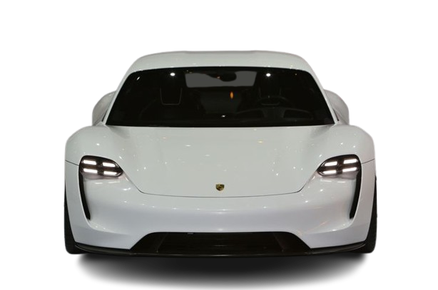
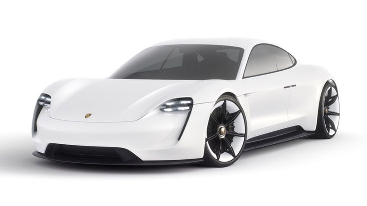
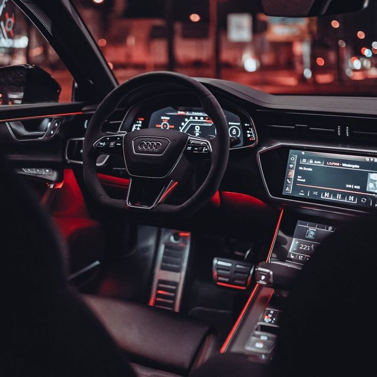
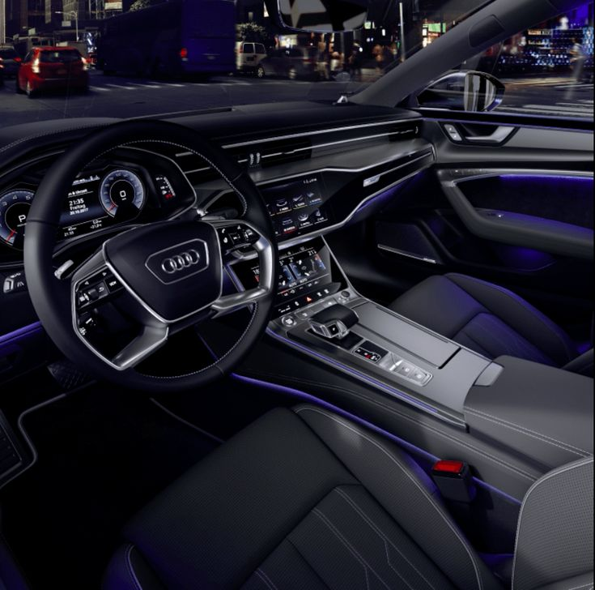
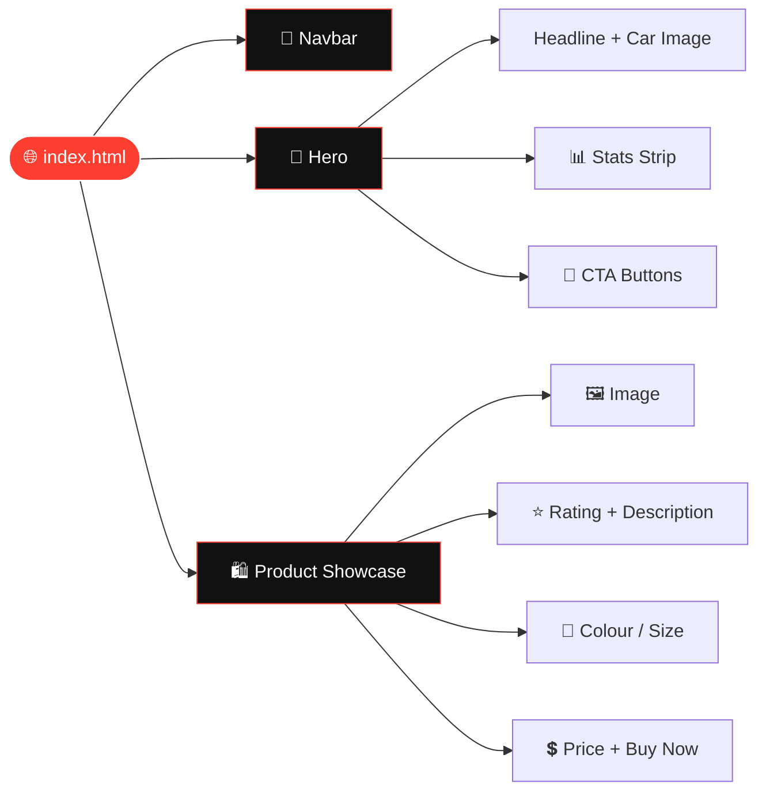

<!-- Developed by Syed Muhammad Tayyab -->
<div align="center">


<a href="https://github.com/Syed-Muhammad-Tayyab/Drive-Nova">
  
</a>

<br/>



<br/><br/>


### 🏁 [**Live Demo**](https://syed-muhammad-tayyab.github.io/Drive-Nova/) &nbsp;•&nbsp; 🐞 [**Report Bug**](https://github.com/Syed-Muhammad-Tayyab/Drive-Nova/issues/new?template=bug_report.md) &nbsp;•&nbsp; ✨ [**Request Feature**](https://github.com/Syed-Muhammad-Tayyab/Drive-Nova/issues/new?template=feature_request.md)

</div>

---


## 📑 Table of Contents

| # | Section | # | Section |
|:-:|---|:-:|---|
| 1 | [🚀 About](#-about-the-project) | 7 | [🧩 Page Sections](#-page-sections) |
| 2 | [✨ Features](#-features) | 8 | [🎨 Customization](#-customization) |
| 3 | [📸 Gallery](#-gallery) | 9 | [🗺️ Roadmap](#%EF%B8%8F-roadmap) |
| 4 | [🛠️ Tech Stack](#%EF%B8%8F-tech-stack) | 10 | [🤝 Contributing](#-contributing) |
| 5 | [📂 Repo Structure](#-repository-structure) | 11 | [📄 License](#-license) |
| 6 | [⚡ Quick Start](#-quick-start) | 12 | [👨‍💻 Author](#-author) |

---

## 🚀 About The Project

> **Drive-Nova** is a sleek, dark-themed **car showcase landing page** built with pure **HTML** and **Tailwind CSS v4**.
> It spotlights the electric **Porsche Mission E** in the hero, followed by a premium product card featuring an **Audi** interior shot, ratings, colour and size pickers, pricing and a Buy Now call-to-action.

```diff
+ Zero build step        + Zero dependencies to install
+ Mobile-first layout    + Deploys to GitHub Pages in one push
```

<div align="center">

| ⚡ Setup Time | 📦 Dependencies | 🧱 Framework | 📱 Responsive |
|:-:|:-:|:-:|:-:|
| **< 1 min** | **0 (CDN only)** | **None** | **Yes** |

</div>

---

## ✨ Features

<table>
<tr>
<td width="50%">

### 🧭 Smart Navigation
- Fixed top navbar with brand logo
- Home · About · Popular · Feature · Contact
- Hamburger toggle on small screens

</td>
<td width="50%">

### 🦸 Impactful Hero
- Bold **"Choose The Best Car"** headline
- Transparent-PNG Porsche Mission E
- **Get started** and **Explore** CTAs

</td>
</tr>
<tr>
<td width="50%">

### 📊 Stats Strip
- Downloads · Users · Files · Places
- Red line-icons with large counters
- Responsive 4 → 2 → 1 column grid

</td>
<td width="50%">

### 🛍️ Product Showcase
- Large Audi interior image
- ⭐ Star rating with review count
- Colour swatches + size dropdown
- Price, **Buy Now** and wishlist heart

</td>
</tr>
<tr>
<td width="50%">

### 🎨 Dark Premium Look
- Black canvas with `#fc3f31` red accent
- High-contrast typography
- Smooth hover states on buttons & links

</td>
<td width="50%">

### 🌐 Deploy Anywhere
- Static files only
- GitHub Pages workflow included
- Works on Netlify, Vercel, Cloudflare Pages

</td>
</tr>
</table>

---

## 📸 Gallery

<div align="center">

| 🏎️ Hero Car | 🪑 Interior Showcase | 🚘 Sportback |
|:-:|:-:|:-:|
|  |  |  |
| *Porsche Mission E* | *Audi Interior* | *Audi A7 Sportback* |

</div>

---

## 🛠️ Tech Stack

<div align="center">


</div>

| Layer | Technology | Why |
|---|---|---|
| 🧱 Markup | **HTML5** | Semantic, accessible structure |
| 🎨 Styling | **Tailwind CSS v4** (`@tailwindcss/browser` via jsDelivr CDN) | Utility-first, no build step |
| 🖼️ Assets | PNG / JPG | Transparent hero + photo showcase |
| 🚀 Hosting | **GitHub Pages** | Free static hosting via included workflow |

---

## 📂 Repository Structure

```bash
🚗 Drive-Nova/
│
├── 📄 index.html                  # The whole landing page
├── 📘 README.md                   # You are here
├── 📜 LICENSE                     # MIT
├── 📝 CHANGELOG.md                # Version history
├── 🤝 CONTRIBUTING.md             # Contribution guide
├── 🔐 SECURITY.md                 # Security policy
├── 🙈 .gitignore
│
├── 🖼️ assets/
│   ├── badges/                    # Local SVG badges (never break)
│   └── images/
│       ├── hero-porsche-mission-e.png   # Transparent hero car
│       ├── hero-original.jpg            # Original hero photo
│       ├── audi-interior.jpg            # Product showcase image
│       ├── audi-a7-sportback.jpg        # Extra gallery image
│       └── favicon.png                  # Logo / favicon
│
├── 📚 docs/
│   ├── ARCHITECTURE.md            # How the page is built
│   └── CUSTOMIZATION.md           # What to edit for what
│
└── ⚙️ .github/
    ├── ISSUE_TEMPLATE/
    │   ├── bug_report.md
    │   └── feature_request.md
    ├── PULL_REQUEST_TEMPLATE.md
    └── workflows/
        └── pages.yml              # Auto-deploy to GitHub Pages
```

---

## ⚡ Quick Start

### 1️⃣ Clone

```bash
git clone https://github.com/Syed-Muhammad-Tayyab/Drive-Nova.git
cd Drive-Nova
```

### 2️⃣ Run

No install needed. Just open the file:

```bash
# macOS
open index.html
# Windows
start index.html
# Linux
xdg-open index.html
```

Or serve it locally:

```bash
npx serve .
# or
python -m http.server 5500
```

> 💡 **Tip:** use the VS Code **Live Server** extension for instant reload while editing.

### 3️⃣ Deploy to GitHub Pages 🌍

1. Push the repo to GitHub
2. Go to **Settings → Pages → Source → GitHub Actions**
3. The included `pages.yml` workflow publishes on every push to `main`
4. Your site goes live at `https://syed-muhammad-tayyab.github.io/Drive-Nova/`

> ℹ️ The page loads Tailwind from a CDN, so an internet connection is required when viewing it.

---

## 🧩 Page Sections



| Section | What it does |
|---|---|
| 🧭 **Navbar** | Fixed header with logo, brand and 5 links; collapses to a hamburger on mobile |
| 🦸 **Hero** | Headline, featured car, 4 stat counters, primary and secondary buttons |
| 🛍️ **Showcase** | Image + details card with rating, swatches, size select, price and actions |

---

## 🎨 Customization

<details>
<summary><b>🖌️ Click to expand the customization cheatsheet</b></summary>

<br/>

| I want to… | Do this |
|---|---|
| Change the brand name | Edit the `<span>` beside the logo in `<nav>` |
| Swap the hero car | Replace `assets/images/hero-porsche-mission-e.png` (use a transparent PNG) |
| Change the accent colour | Search `#fc3f31` and `red-500` in `index.html` |
| Edit the stats | Change the four `<h2>` numbers in the hero |
| Update product info | Edit title, description, price and swatches in the Content section |
| Change the favicon | Replace `assets/images/favicon.png` |

More details in [`docs/CUSTOMIZATION.md`](./docs/CUSTOMIZATION.md).

</details>

<details>
<summary><b>🎨 Colour palette</b></summary>

<br/>

| Swatch | Hex | Usage |
|:-:|:-:|---|
|  | `#000000` | Page background |
|  | `#fc3f31` | Primary CTA, accents |
|  | `#ffffff` | Headings, text |
|  | `#6b7280` | Secondary text |

</details>

---

## 🗺️ Roadmap

- [x] Responsive navbar with mobile toggle
- [x] Hero section with featured car
- [x] Stats strip
- [x] Product showcase card
- [x] Organised repo, docs and GitHub Pages workflow
- [ ] Replace placeholder text (title, description, brand) with real car details
- [ ] Add an About / Popular / Features content for each nav link
- [ ] Car gallery slider using the Audi A7 Sportback image
- [ ] Working colour and size selection
- [ ] Contact form section
- [ ] Light / dark theme switch
- [ ] Scroll animations

> 💬 Have an idea? [Open a feature request](https://github.com/Syed-Muhammad-Tayyab/Drive-Nova/issues/new?template=feature_request.md).

---

## 🤝 Contributing

Contributions make open source great. 💖

```bash
# 1. Fork the repo, then:
git checkout -b feat/amazing-feature
git commit -m "feat: add amazing feature"
git push origin feat/amazing-feature
# 2. Open a Pull Request 🎉
```

Please read [`CONTRIBUTING.md`](./CONTRIBUTING.md) first.

---

## 📄 License

Distributed under the **MIT License**. See [`LICENSE`](./LICENSE) for details.

> 🖼️ Car photos are used for demonstration purposes only and belong to their respective owners.

---

## 👨‍💻 Author

<div align="center">

<a href="https://github.com/Syed-Muhammad-Tayyab">
  
</a>

### **Syed Muhammad Tayyab**
*BSCS Student • Information Security • Web Developer*

[**🔗 github.com/Syed-Muhammad-Tayyab**](https://github.com/Syed-Muhammad-Tayyab)

<br/>

### ⭐ If you like this project, give it a star!


</div>


<div align="center">
  <sub>🚗 <b>Drive-Nova</b> — Developed by <b>Syed Muhammad Tayyab</b> • © 2026</sub>
</div>
