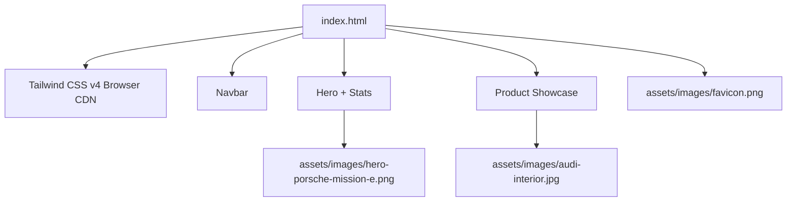

# 🏗️ Architecture

> Developed by Syed Muhammad Tayyab

Drive-Nova is a **single-page static site**. No bundler, no framework, no server.

## Sections inside `index.html`
| Section | Purpose |
|---|---|
| `<nav>` | Fixed top bar: logo, brand name, Home / About / Popular / Feature / Contact |
| Hero | Headline, featured car, 4 stat counters, *Get started* + *Explore* buttons |
| Content | Product card: image, rating, description, colour & size options, price, Buy Now, wishlist |

## Design tokens
- Background: `bg-black`
- Accent: `#fc3f31` / `red-500`
- Text: white headings, `gray-500` secondary
